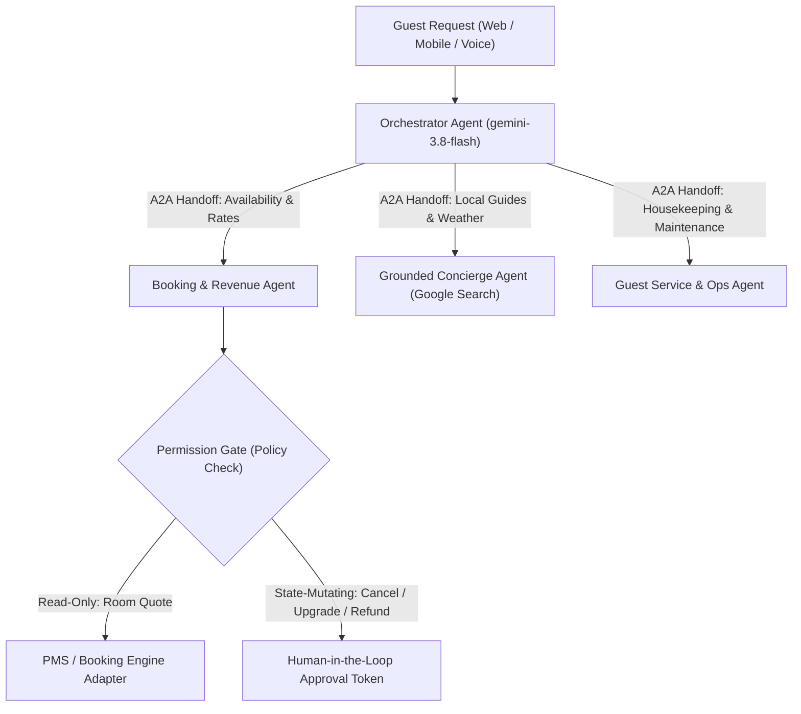

# Hospitality Multi-Agent Reference Architecture (Google Gemini & A2A)

[](LICENSE)
[](https://www.python.org/)
[](https://aistudio.google.com/)

A production-inspired **Multi-Agent System Reference Architecture** for the hospitality industry, built on the **Google Gemini Interactions API (`google-genai >= 2.30.1`)**, **Agent-to-Agent (A2A) delegation patterns**, **Google Search Grounding**, and **Human-in-the-Loop Permission Gates**.

Designed and open-sourced by [Patryk Wodniak](https://github.com/productroot) (*AI Lead @ Profitroom & International Speaker*) to demonstrate how enterprise hospitality platforms coordinate specialized AI agents safely.

---

## 🏛️ Architecture Overview



### Core Design Pillars

1. **Specialized Sub-Agents with Scoped Tools:**
   - **Orchestrator Agent:** Classifies intent, maintains stateful conversation context (`previous_interaction_id`), and delegates to domain specialists.
   - **Booking & Direct Perks Agent:** Checks real-time room availability, dynamic rate plans (flexible vs. non-refundable), and child age-band pricing rules.
   - **Grounded Concierge Agent:** Uses live **Google Search Grounding** (`{"type": "google_search"}`) to answer hyper-local questions about events, restaurants, and transit around the property.
   - **Service & Operations Agent:** Dispatches housekeeping, late check-out, and maintenance tickets.
2. **Product-Level Permission Gates (`PermissionGate`):**
   - Models do not hold raw write credentials. Every state-mutating tool call (`modify_reservation`, `issue_refund_voucher`) passes through a deterministic policy gate requiring explicit confirmation or supervisor approval above configurable financial thresholds.
3. **Stateful Interactions API:**
   - Uses `client.interactions.create()` with `gemini-3.8-flash` (and `gemini-4-argon` for complex multi-constraint itinerary planning) and step-based tool execution (`function_call` → `function_result`).

---

## 📂 Project Structure

```text
hospitality-multi-agent-gemini/
├── agents/
│   ├── __init__.py
│   ├── permission_gate.py   # Deterministic safety & HITL approval layer
│   ├── tools.py             # Hospitality tool definitions & mock PMS adapter
│   └── orchestrator.py      # Multi-agent router & Gemini Interactions API loop
├── tests/
│   └── test_permission_gate.py
├── app.py                   # FastAPI HTTP endpoint & CLI demo
├── requirements.txt
├── .env.example
└── LICENSE
```

---

## 🚀 Quick Start

```bash
git clone https://github.com/productroot/hospitality-multi-agent-gemini.git
cd hospitality-multi-agent-gemini
python3 -m venv .venv
source .venv/bin/activate
pip install -r requirements.txt
```

Set your Gemini API key and run the interactive demo or test suite:

```bash
export GEMINI_API_KEY="your-api-key"
pytest
python app.py --demo
```

---

## 📄 License

MIT License — Created by [Patryk Wodniak](https://github.com/productroot).
